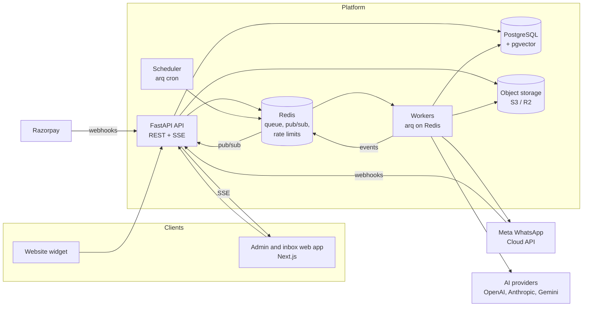
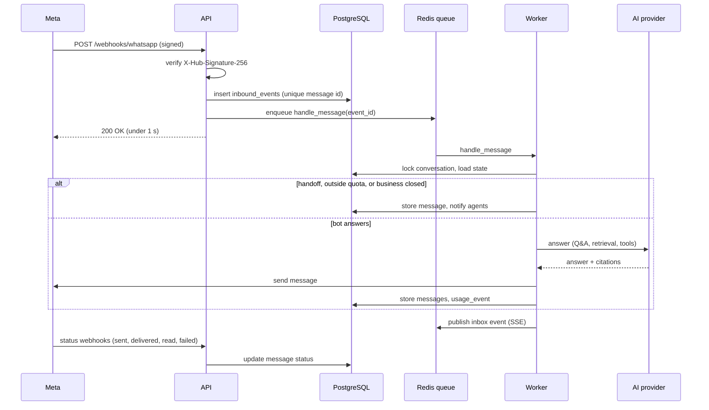

# Design: AI chatbot for WhatsApp and websites

| | |
|---|---|
| Status | Draft for review |
| Last updated | 2026-10-28 |
| Requirements | [REQUIREMENTS.md](REQUIREMENTS.md) (IDs such as `INB-1` refer to it) |

## 1. Goals

- Deliver release R1 (a sellable MVP) on the existing FastAPI code base, without a rewrite.
- Never lose or double-answer a customer message, even when a server or AI provider fails.
- Keep every tenant's data separate, and keep each tenant's AI cost measurable and capped.
- Leave room for R2 and R3 (campaigns, tools, agencies) without reworking the core.

**Non-goals:** microservices, Kubernetes, multi-region. One region on a few servers covers the first-year scale (NFR-3).

## 2. Current system (v0.2)

```text
Meta webhook ─┐
Website widget ┼─► FastAPI (app/main.py) ──► PostgreSQL + pgvector
Admin (curl) ──┘        │  background tasks: ingest, WhatsApp replies
                        └─► OpenAI / Anthropic / Gemini, Meta Graph API
```

| Module | Role today |
|---|---|
| `app/main.py` | Routes, admin-key auth, CORS |
| `app/rag.py` | Hybrid retrieval, follow-up rewriting, answers, in-memory rate limiter |
| `app/llm.py` | Chat providers (OpenAI, Anthropic, Gemini) and embedders |
| `app/whatsapp.py` | Webhook parsing, signature check, dedupe, replies, keyword handoff |
| `app/ingest.py` | Structure-aware parsing and chunking |
| `app/evaluate.py` | Accuracy test runs |
| `app/db.py` | Models; tables created at startup |

**Limits to fix first:**
- Background tasks are lost on restart.
- One shared Meta token and admin keys, with no user accounts.
- No migrations.
- Rate limits are in memory, per process.
- Files live on local disk.

## 3. Target architecture



| Component | Responsibility |
|---|---|
| **Web app** (`web/`, Next.js + TypeScript) | Sign-up, onboarding, knowledge, bot settings, inbox, leads, analytics, billing, platform admin. Talks only to the API. |
| **API** (`app/`, FastAPI) | Auth, validation, CRUD, webhook intake (verify, store, enqueue, acknowledge), live updates over SSE. No AI calls in the request path except the website chat preview. |
| **Workers** (arq) | Everything slow or retryable: answering messages, ingestion, OCR, sending messages, campaigns, outgoing webhooks, usage rollups. |
| **Scheduler** (arq cron) | Campaign sends, reminders, re-crawls, retention clean-up, daily usage rollups, plan renewals. |
| **PostgreSQL** | System of record, including vectors (pgvector) and keyword search (`tsvector`). |
| **Redis** | Job queue, pub/sub for live inbox updates, shared rate limits and quotas, short-lived locks. |
| **Object storage** | Uploaded files and media (private bucket, signed URLs). |

## 4. Key decisions

| # | Decision | Chosen | Why | Alternatives considered |
|---|---|---|---|---|
| D1 | Job queue | **arq** on Redis | Async Python, small, retries and cron built in, fits FastAPI | Celery (heavier), RQ (sync only), Postgres queue (fine at small scale, but we also need Redis for pub/sub) |
| D2 | Admin front end | **Next.js + TypeScript** in `web/` | Same stack as GreenPlot; good for dashboards and an installable inbox | Server-rendered Jinja (fast to start, poor for a live inbox) |
| D3 | Admin auth | **Session cookies** (httpOnly, Secure, SameSite=Lax) + CSRF token; Argon2 passwords; Google sign-in | Simple and safe for a first-party web app; easy to revoke | JWT in local storage (harder to revoke, XSS risk) |
| D4 | Public API auth | **Scoped API keys**, hashed, per tenant | Standard for integrations (API-1) | OAuth apps (R3+ if needed) |
| D5 | Multi-tenancy | Shared tables with `tenant_id`, enforced in a repository layer and checked by tests | Already in place; cheapest to run | Schema per tenant (harder migrations), row-level security (possible later as defence in depth) |
| D6 | Secrets at rest | **Envelope encryption**: a data key per tenant, encrypted by a master key from the environment or a cloud KMS | Per-tenant Meta tokens and connector credentials must not sit in plain text | Plain columns (unacceptable), external vault (more operational work for now) |
| D7 | Live inbox updates | **Server-Sent Events** over Redis pub/sub | One-way updates are enough; works through proxies; simpler than WebSockets | WebSockets, polling |
| D8 | Migrations | **Alembic**, with a baseline of the v0.2 schema | Needed before any customer data exists | Recreating the database (only acceptable in development) |
| D9 | File storage | **S3-compatible** (AWS S3 Mumbai or Cloudflare R2), local disk in development | Shared between API and workers; durable | Local volume (breaks with more than one server) |
| D10 | Billing | **Razorpay Subscriptions** first, behind a `BillingProvider` interface; Stripe later | India-first; UPI and cards; GST invoices | Stripe only (weaker for Indian SMBs) |
| D11 | WhatsApp access | **Meta Tech Provider** with Embedded Signup; each business owns its WABA and token | Businesses keep ownership; no per-message reseller fees | BSP partnership (faster start, less control, adds cost); open question in REQUIREMENTS §10 |

## 5. Message pipeline

Every inbound message is stored before Meta gets its 200 response, then processed by a worker. That makes a server restart or a provider outage safe (NFR-2).



**Design points:**

- **Idempotency.** `inbound_events.channel_message_id` is unique, so a retried webhook is stored once. The worker marks the event `processed`, so a retried job doesn't answer twice. Outgoing messages carry a client reference, so a send retried after a timeout is detected through Meta's status webhook.
- **Ordering.** Messages in one conversation are processed one at a time, using a per-conversation lock (Postgres advisory lock keyed by conversation). Several quick messages from a customer are merged into one turn when they arrive within about 2 seconds of each other ("debounce"), so the bot doesn't answer each fragment.
- **Retries.** AI and Meta errors are retried with exponential backoff (up to 5 attempts in about 10 minutes). After that, the conversation goes to `waiting_for_agent` with an internal note, and the customer gets a short apology. A message is never dropped silently.
- **Quota and hours.** Before calling the AI, the worker checks the tenant's monthly quota (Redis counter, reconciled with Postgres) and business hours. If over quota, the owner's choice applies: pause with handoff, or overage (BIL-4).
- **24-hour window.** `conversations.last_inbound_at` drives whether free-form replies are allowed (INB-4). Outside the window, only approved templates can be sent.
- **Website chat** uses the same worker path. The widget gets the answer over SSE (or by short polling as a fallback) instead of waiting on a long HTTP request.

## 6. Answer engine

```text
question
  → language detection → (optional) translate query for search
  → exact Q&A match (qa_pairs, high-similarity threshold)  ──► answer directly, cite "FAQ"
  → follow-up rewrite (exists)
  → hybrid retrieval (exists) → optional reranker
  → model call with tools enabled for this tenant
       tools: search_knowledge, query_table, lookup_order, check_slots, create_booking,
              send_payment_link, capture_lead, handoff
  → grounding check (R3): drop or flag claims not supported by cited text
  → reply in the customer's language, with citations
```

- **Provider-neutral tools.** Add `ChatProvider.run(model, system, messages, tools) -> ChatResult` alongside `complete`. Each adapter maps a common `Tool` schema to that provider's function-calling format (OpenAI tools, Anthropic tool use, Gemini function declarations). The loop runs at most 5 tool calls per turn. Every tool call is logged with its inputs and result (BOT-6).
- **Lead capture (LEAD-1)** is the `capture_lead` tool. The tenant's lead fields are described in the system prompt; the model calls the tool as it learns details, and the worker upserts the lead.
- **Exact answers from spreadsheets (KN-5).** Uploaded CSV and XLSX files are also loaded into a per-tenant schema (`t_<tenant>.<table>`). The `query_table` tool runs a model-written `SELECT` as a read-only database role with a statement timeout and row limit. Only the tenant's own schema is on that role's search path.
- **Prompting.** The system prompt has three layers: the platform's safety and grounding rules, the industry template, and the tenant's persona and rules (BOT-1). The tenant's text is placed after the platform rules and labelled as business instructions, so it can't override them.
- **Cost control.** Each plan maps to a default model (REQUIREMENTS §7). Follow-up rewriting and reranking use the cheapest model of the tenant's provider. Token usage from every call is recorded (§9).

## 7. Data model changes

All tables have `tenant_id` (except platform tables), `created_at` and `updated_at`. New or changed tables:

| Table | Key columns | Notes |
|---|---|---|
| `users` | id, email (unique), password_hash, name, email_verified_at, totp_secret_enc | Platform-wide identity |
| `memberships` | user_id, tenant_id, role | Role per tenant (owner, admin, agent, viewer) |
| `sessions` | id (random, hashed), user_id, expires_at, ip, user_agent | Revocable |
| `api_keys` | tenant_id, name, key_hash, scopes, last_used_at | Replaces the admin key |
| `tenants` | + plan_id, industry, persona, tone, rules, business_hours, timezone, language_default, data_key_enc | Bot settings move here from env |
| `channels` | tenant_id, kind (whatsapp, web, instagram), external_id (phone number ID), display_name, credentials_enc, status, quality_rating | Replaces `tenants.whatsapp_phone_number_id` and the global Meta token |
| `contacts` | tenant_id, channel, external_user, name, language, opt_in_at, opt_out_at, attributes (JSONB) | One per customer per channel |
| `conversations` | + contact_id, channel_id, status (bot, waiting, agent, closed), assignee_user_id, labels, last_inbound_at, last_message_at | `handoff` becomes `status` |
| `messages` | + direction, author_user_id, kind (text, template, image, voice, note), channel_message_id, delivery_status, error | Notes are internal (not sent) |
| `inbound_events` | channel_message_id (unique), payload (JSONB), status, attempts, last_error | Durable intake (§5) |
| `qa_pairs` | tenant_id, question, answer, embedding | KN-3 |
| `sources` | + kind (file, url, drive), storage_key, url, crawl_schedule, checksum | Files move to object storage |
| `leads` | tenant_id, contact_id, conversation_id, status, owner_user_id, fields (JSONB), notes | LEAD-1, LEAD-2 |
| `templates` | tenant_id, channel_id, name, language, category, body, variables, meta_status | CMP-1 |
| `campaigns` / `campaign_recipients` | template, segment, scheduled_at, status; per recipient: status, message_id, error | CMP-3, CMP-4 |
| `services` / `slots` / `bookings` | as named | APT-1 |
| `feedback` | message_id, rating, comment | ANL-3 |
| `usage_events` | tenant_id, kind (ai_message, tokens_in, tokens_out, ocr_page), provider, model, quantity, cost_micros, occurred_at | Append-only; rolled up daily into `usage_daily` |
| `plans` / `subscriptions` / `invoices` | limits as JSONB; provider IDs; GST fields | BIL-1 to BIL-3 |
| `audit_log` | tenant_id, actor (user, API key, system), action, target, ip, details | Append-only (NFR-5) |
| `webhook_endpoints` / `webhook_deliveries` | url, secret_enc, events; delivery attempts | API-2 |

## 8. Auth and permissions

- **Every request** resolves to a principal (user session or API key) and a tenant. Repository functions take the tenant from that context, never from request bodies. A test checks that every tenant-scoped route returns 404 for another tenant's IDs.
- **Permission matrix** (summary):

| Action | Owner | Admin | Agent | Viewer |
|---|---|---|---|---|
| Billing, delete workspace, manage owners | ✓ | | | |
| Users, channels, bot settings, knowledge, campaigns | ✓ | ✓ | | |
| Inbox reply, notes, assign, leads | ✓ | ✓ | ✓ | |
| View dashboards and transcripts | ✓ | ✓ | ✓ | ✓ |

- **Sessions** last 14 days with sliding renewal. They are revoked on password change. Login, failed login and role changes are audited.
- The **platform admin** is a flag on `users`. Impersonation creates a separate, time-limited session marked in the UI and the audit log (ADM-2).
- **Migration from admin keys:** existing tenant admin keys keep working as API keys with full scope until each tenant creates an owner account.

## 9. Usage metering and billing

1. Every AI call records a `usage_event` with provider, model, input and output tokens, and cost. Cost comes from a price table in config (`model → ₹ per million tokens`).
2. A Redis counter per tenant per month is checked before each answer (§5). A daily job reconciles it with `usage_events` and fills `usage_daily`.
3. At 80% and 100% of quota, the owner is notified by email and in the app.
4. Razorpay subscription webhooks (signature verified, processed once by event ID) update `subscriptions`. Invoices are generated monthly with the customer's GSTIN, the SAC code for the service (to confirm with an accountant), and CGST/SGST or IGST depending on the customer's state.
5. **Plan changes** take effect immediately for upgrades (prorated) and at period end for downgrades. **Failed payments** get a 7-day grace period, then the bot is paused (with handoff) until payment.

## 10. WhatsApp integration

- **Embedded Signup (CH-1).** The web app launches Meta's signup popup. On success, the API exchanges the returned code for a business token, stores it encrypted in `channels.credentials_enc`, subscribes the app to the business's WhatsApp Business Account, and registers the phone number. The global `WHATSAPP_ACCESS_TOKEN` is then only used for the platform's own number.
- **Webhooks.** One endpoint for all tenants, routed by `phone_number_id` (as today). Message status webhooks update `messages.delivery_status`. Template status webhooks update `templates.meta_status`. Quality and limit updates go to `channels`.
- **Templates and campaigns (CMP).** Templates are created through the Graph API and tracked until approved. Campaign sends are throttled per channel to the number's messaging limit, with a send rate the channel can sustain. Each recipient is a job, so failures are retried individually. Contacts who opted out are excluded at send time, and "STOP" (or a localised equivalent) sets `opt_out_at`.
- **Media (CH-5).** Media is downloaded through the Graph API, stored in object storage, and voice notes are transcribed (provider speech-to-text) before answering.

## 11. Admin web app

| Area | Screens |
|---|---|
| Onboarding | Sign-up, verify email, workspace, industry template, connect WhatsApp, add knowledge, test chat, go live |
| Inbox | Conversation list (filters, counts), conversation view (messages, sources used, notes, contact and lead panel), 24-hour window indicator, template picker |
| Knowledge | Files and URLs with status, Q&A pairs, "improve answers" queue |
| Bot | Persona, tone, rules, hours, languages, provider and model, test chat with sources shown |
| Leads | Table, statuses, export, integrations |
| Campaigns | Templates, contacts and segments, campaigns, results |
| Analytics | Overview (ANL-1), top and unanswered questions, accuracy runs |
| Settings | Team, channels, billing and usage, API keys, webhooks, audit log |
| Platform admin | Tenants, usage and cost, plans, suspensions |

Built with Next.js App Router, TypeScript and a component library (for example shadcn/ui). The inbox is an installable PWA with web push for new waiting conversations (INB-6). An OpenAPI-generated client keeps the front end in step with the API.

## 12. Security and privacy

- **Webhooks.** Every inbound webhook is signature-checked: Meta (`X-Hub-Signature-256`, exists), Razorpay (`X-Razorpay-Signature`). Outgoing webhooks are signed with a per-endpoint secret.
- **Encryption.** Encrypted at rest (D6): tokens, connector credentials, TOTP secrets and webhook secrets. Database and storage disks are encrypted by the host.
- **Abuse.** Per-IP and per-tenant rate limits in Redis. Upload type and size checks (exist), plus a malware scan of uploads (ClamAV). A cap on tool calls per turn.
- **Prompt injection.** Knowledge and tool results are passed as untrusted data (as today). Tools that change things (`create_booking`, `send_payment_link`) take only the values the tool schema allows, and every call is audited.
- **Privacy (NFR-6, NFR-8).**
  - Data export and deletion per contact and per tenant run as background jobs.
  - A nightly retention job removes conversations past the tenant's retention period.
  - Customers' personal data is never used to train models; this is stated in the terms.
  - A breach response runbook is kept with the operations docs.

## 13. Observability

- **Logs:** structured JSON with `tenant_id`, `conversation_id` and `job_id`.
- **Errors:** Sentry for the API, workers and web app.
- **Metrics** (Prometheus/Grafana or a hosted equivalent): webhook latency, queue depth and age, job failures, AI latency and errors per provider, messages per tenant, cost per tenant.
- **Alerts:** no webhook received in 15 minutes during business hours, queue older than 60 seconds, Meta send failures above 2%, a provider error spike.

## 14. Deployment

| Stage | Setup |
|---|---|
| Development | `docker compose`: api, worker, web, postgres (pgvector), redis, minio |
| Staging and production (R1) | One or two VMs in an Indian region; Docker Compose; managed PostgreSQL with daily backups and point-in-time recovery; managed Redis; S3 or R2; Cloudflare in front for TLS and the WAF |
| Later | Separate worker VMs as message volume grows; read replica for analytics |

CI (exists) adds type checks, front-end tests and a migration check. Deploys go through staging, with Alembic migrations run before the new API starts.

## 15. Testing

- **Unit and integration tests** against real Postgres + pgvector and Redis (pattern exists in `tests/`). Fake AI providers and a fake Meta Graph API.
- **Tenant isolation tests** for every scoped route (§8).
- **Pipeline tests:** duplicate webhooks, worker crash mid-answer, provider timeout, quota exceeded, outside the 24-hour window.
- **Accuracy:** each industry template's test set runs nightly against the real default model, and the score is tracked (NFR-4).
- **End-to-end:** Playwright tests for onboarding, inbox reply and billing flows in the web app.

## 16. Migration from v0.2

1. Add Alembic with a baseline migration matching the current schema. From here on, every change is a migration.
2. Add users, memberships and sessions. Existing admin keys become API keys (§8).
3. Move uploads to object storage, with a one-off copy job.
4. Add `inbound_events` and arq workers. Switch WhatsApp handling and ingestion from FastAPI background tasks to jobs.
5. Add `channels`, then move the tenant's phone number ID into it.
6. Build the web app on the new endpoints. The API-only routes stay for integrations.

## 17. Delivery plan for R1

| # | Milestone | Contents | Size |
|---|---|---|---|
| M1 | Foundations | Alembic, users and sessions, roles, API keys, object storage, audit log | M |
| M2 | Durable pipeline | `inbound_events`, arq workers, per-conversation locks, retries, status webhooks, Redis rate limits | M |
| M3 | Admin app shell | Next.js app, auth screens, onboarding checklist, knowledge and bot settings screens | L |
| M4 | Inbox | Conversation states, assignment, notes, SSE live updates, 24-hour window, web push | L |
| M5 | Leads and Q&A | `capture_lead` tool (first use of provider-neutral tools), leads screen, Q&A pairs | M |
| M6 | Channels | Embedded Signup, per-tenant tokens, widget styling and handoff button | M |
| M7 | Billing | Plans, metering, quotas, Razorpay subscriptions, GST invoices, platform admin console | L |
| M8 | Pilot launch | One industry template with its test set, analytics overview, monitoring and alerts, terms and privacy policy | M |

S, M and L mean roughly one, two and three to four weeks for one developer. M1 and M2 come first; M3 to M7 can overlap.

## 18. Risks

| Risk | Impact | Mitigation |
|---|---|---|
| Meta Tech Provider approval takes long or is refused | No self-serve WhatsApp onboarding | Start the application early; fall back to a BSP partner for pilots (D11) |
| AI costs exceed plan prices | Losses on heavy tenants | Metering and hard quotas from day one; cheaper default models; Q&A pairs answer common questions without retrieval |
| Wrong answers damage trust | Churn, reputation | Test sets per tenant, citations, decline-when-unsure, grounding check (R3), easy handoff |
| Meta policy or pricing changes | Campaign economics change | Keep Meta billing businesses directly (v1); monitor Meta announcements |
| Data protection obligations | Legal exposure | DPDP-aligned consent, export and deletion; data processing agreement; India data residency |
| Scope creep before first customers | Late launch | Hold to the R1 list; validate pricing and the launch industry with pilots first |
