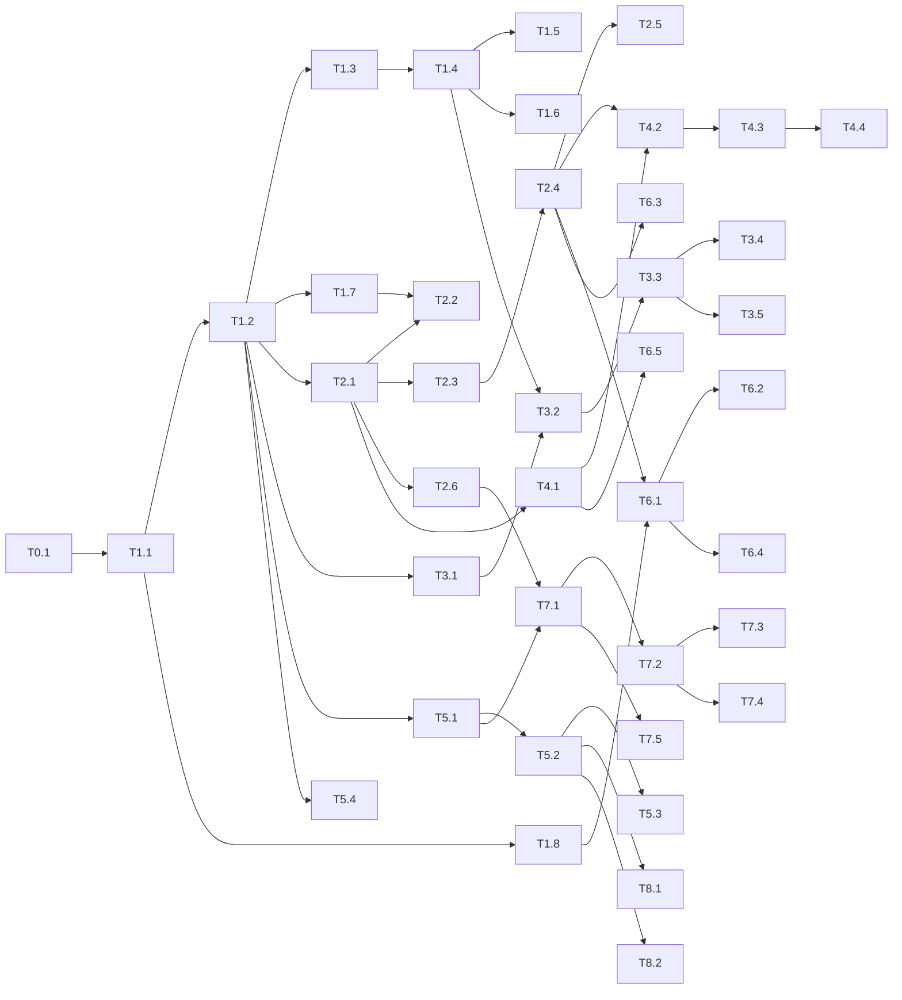

# Implementation plan (step by step, for AI coding agents)

| | |
|---|---|
| Status | Draft for review |
| Last updated | 2026-10-28 |
| Derived from | [REQUIREMENTS.md](REQUIREMENTS.md), [DESIGN.md](DESIGN.md), [INTEGRATIONS.md](INTEGRATIONS.md), [UX_DESIGN.md](UX_DESIGN.md) |

This plan breaks the product into small, ordered tasks. Each task is sized so that one session with any AI coding tool (ChatGPT/Codex, Gemini, Claude, Cursor, Copilot and others; see §2.1) can build, test and open a pull request for it, and so that a human can review it in under an hour. Tasks name the requirement IDs they deliver, so every line of code traces back to the documents above.

## 1. How to use this plan

1. **Pick the first task whose dependencies are all merged.** Tasks are numbered in build order (`T<milestone>.<n>`). Status is tracked in §6.
2. **Start a fresh session per task** on a new branch named `feat/<task-id>-<short-name>` (for example `feat/t1-3-users-sessions`).
3. **Give the agent the prompt in §2**, with the task ID filled in. The agent reads `AGENTS.md`, this plan's §3 and §4, the task, and the requirement IDs it lists.
4. **One task = one pull request.** If a task turns out bigger than expected, the agent stops after a coherent part, opens the PR, and proposes how to split the rest.
5. **After merge,** tick the task in §6 and note anything that changed the plan (new decisions, renamed modules) in the task's "Notes" line.

## 2. Session prompt template

Copy this into a new session, replacing `<TASK-ID>`. It works with any tool that can read and edit the repository; §2.1 covers chat-only tools.

```text
Implement task <TASK-ID> from docs/IMPLEMENTATION_PLAN.md.

1. Read AGENTS.md, sections 3 and 4 of docs/IMPLEMENTATION_PLAN.md, the task itself,
   and every requirement ID it lists (REQUIREMENTS.md, INTEGRATIONS.md, UX_DESIGN.md)
   plus the DESIGN.md sections it references.
2. Check that the task's dependencies are merged on main. If not, stop and say which.
3. Before coding, reply with a short plan: files you will change, migrations, endpoints,
   and the tests you will write. Then implement it.
4. Follow the conventions in section 3 and meet every item in "Definition of done" (section 4).
5. Do only this task. If you find a bug or gap outside it, note it in the PR description
   instead of fixing it.
6. Open a pull request titled "<TASK-ID>: <task title>" whose description lists the
   requirement IDs delivered, what was tested, and anything left for later.
   (If you can't open pull requests, give me the branch name and the PR text instead.)
```

### 2.1 Using different AI tools

The plan works with any model and tool. The repo-level rules are in `AGENTS.md`, the one file all tools share. Small pointer files make each tool find it automatically:

| Tool | How it finds the rules | How to run a task |
|---|---|---|
| **OpenAI Codex** (CLI, IDE or cloud), ChatGPT with Codex | Reads `AGENTS.md` automatically | Open the repo, paste the §2 prompt |
| **Gemini CLI**, Gemini Code Assist | `GEMINI.md` imports `AGENTS.md` | Open the repo, paste the §2 prompt |
| **Claude Code** | `CLAUDE.md` imports `AGENTS.md` | Open the repo, paste the §2 prompt |
| **Cursor**, **Windsurf** and similar editors | Read `AGENTS.md` (or attach it to the chat) | Agent mode, paste the §2 prompt |
| **GitHub Copilot** (agent mode or coding agent) | `.github/copilot-instructions.md` points to `AGENTS.md` | Assign an issue containing the §2 prompt, or paste it in agent mode |
| **Chat-only apps** (ChatGPT, Gemini or Claude on the web, with no repo access) | You paste the files in | Follow the steps below |

**With a chat-only app,** the model can't see or run the code, so you act as its hands:

1. **Give it context.** Start a new chat. Paste the §2 prompt, then paste (or upload) `AGENTS.md`, §3–4 of this plan, the task, the requirement sections it lists, and every file named in the task's "Files". If a file is long, paste only the parts the task changes, and say so.
2. **Ask for the plan first,** as in the prompt's step 3. Correct it before any code is written.
3. **Ask for complete files or unified diffs,** one file at a time, with each file's path. For example: "Give me the full new content of app/api/auth.py" or "Give me a git diff I can apply with git apply". Apply them on a new branch.
4. **Run the checks yourself** (`pytest -q`, `ruff check …`, and the frontend checks if `web/` changed). Paste any failures back word for word and ask for fixes. Repeat until everything passes.
5. **Ask for the PR description** (requirement IDs, tests, follow-ups), then commit, push and open the PR yourself.

**Tips that help every model:**

- **One task per session.** Long sessions drift; a fresh session per task keeps the model focused on the plan.
- **Always ask for tests with the code,** and run them before accepting the change. "Tests pass" from a model that hasn't run them is not evidence.
- **Keep the plan as the source of truth.** If the model suggests a different approach, decide, then update this plan (or the design documents) in the same PR, so the next session, whichever model runs it, sees the decision.
- **Review security-sensitive tasks closely** whatever tool wrote them: auth (T1.3–T1.5), encryption (T1.8), webhooks (T2.3, T7.2), billing (T7.x) and the HTTP connector (T10.3).
- **Different models may write the same thing differently.** The conventions in §3 and the tests are what keep the code base consistent; ask the model to match the surrounding code's style.

## 3. Conventions every task follows

### 3.1 Repository layout (target)

```text
app/
  main.py              FastAPI app, middleware, router registration
  config.py            Settings (pydantic-settings, env vars)
  db.py                Engine, session, models (split into app/models/ once it passes ~400 lines)
  api/                 One router module per area: auth.py, tenants.py, knowledge.py, inbox.py, ...
  services/            Business logic used by routes and jobs (no FastAPI imports)
  integrations/        One package per outside system (INTEGRATIONS INT-1)
  jobs/                arq job functions and worker settings
  llm.py, rag.py, ingest.py, whatsapp.py, evaluate.py   (existing; move into services/ when touched)
migrations/            Alembic
web/                   Next.js admin app (from T3.1)
widget/                Website widget
tests/                 pytest; mirrors app/ (tests/api/, tests/services/, ...)
docs/                  These documents
```

### 3.2 Backend rules

- **Python 3.12, FastAPI, SQLAlchemy 2.x** (typed `Mapped[...]` models), **pydantic v2** for request and response bodies.
- **Every schema change has an Alembic migration** (from T1.1). Never rely on `create_all` outside tests.
- **Every tenant-scoped query filters by `tenant_id` from the request context**, never from the request body. Use the helpers added in T1.4.
- **No AI or third-party calls inside a request handler** (INT-7). Use a job (from T2.1). The only exception is "test connection" buttons.
- **Never hold a database session open across an AI or HTTP call** (pattern in `app/rag.py`).
- **Secrets** (tokens, keys) are stored with `app/services/crypto.py` (T1.8) and never logged or returned by the API.
- **Errors** returned to clients use `{"error": {"code", "message", "details"}}` (INTEGRATIONS PAPI-4) once T1.2 adds the handler.
- **Lint:** `ruff check --line-length 120 app tests` must pass.

### 3.3 Tests

- **Run** with `pytest -q`. Tests use real PostgreSQL + pgvector (and Redis from T2.1), as described in the README "Tests" section.
- **Fakes, not network:** AI providers use `FakeChat` and `FakeEmbedder` in `tests/conftest.py`; WhatsApp sends use the `sent` fixture; every new integration gets a fake or recorded responses. Tests must not need API keys or internet access.
- **Every new endpoint gets:**
  1. a happy-path test
  2. an auth test (no credentials → 401, wrong role → 403)
  3. a tenant isolation test (another tenant's ID → 404)
  4. a validation test (bad input → 422)
- **Every bug fix gets a test** that fails before the fix.

### 3.4 Frontend rules (from T3.1)

- **Stack:** Next.js (App Router) + TypeScript (strict), with shadcn/ui on Radix, Tailwind, and design tokens from UX_DESIGN VDS-1.
- **API access** only through the client generated from the API's OpenAPI schema (`web/src/api/`). Regenerate it when the API changes.
- **Every screen** has loading, empty, error and filled states (UX_DESIGN UI-1) and works at 320 px wide (A11Y-4).
- **All UI text** lives in message files (UX_DESIGN L10N-1).
- **Tests:** component tests with Vitest + Testing Library; Playwright end-to-end tests for each flow in UX_DESIGN §4 as it is built; axe accessibility checks on key screens.

### 3.5 Git and PRs

- **Branch** `feat/<task-id>-<name>`. Commit messages say what changed and why.
- **PR description:** requirement IDs delivered, migrations added, how it was tested, screenshots for UI changes, and follow-ups.
- **Size:** keep PRs under about 800 changed lines, excluding generated files and lockfiles. Split if bigger.

## 4. Definition of done (every task)

- [ ] All acceptance criteria in the task are met.
- [ ] Tests added per §3.3; `pytest -q` and `ruff` pass locally, and frontend checks pass if `web/` changed.
- [ ] Migration added and tested up and down, if the schema changed.
- [ ] README or `docs/` updated where behaviour, settings or setup changed; new settings added to `.env.example`.
- [ ] No secrets, personal data or message content in logs.
- [ ] CI green on the PR.
- [ ] §6 status updated in the same PR.

## 5. Tasks

Size: **S** = up to half a day of agent work, **M** = about a day, **L** = 2–3 days (split if possible).

### M0: Preparation

#### T0.1 Add linting and the agent guide to CI
- **Delivers:** foundation for all tasks
- **Depends on:** none
- **Size:** S
- **Steps:**
  1. Add a `ruff.toml` (line length 120, rules E, F, W, I, B, ignoring B008) and run `ruff check` in CI before `pytest`.
  2. Confirm `AGENTS.md` matches the commands in this plan.
- **Done when:** CI fails on a lint error and passes on `main`.

### M1: Foundations (DESIGN §16 steps 1–3, §17 M1)

#### T1.1 Alembic baseline
- **Delivers:** DESIGN D8
- **Depends on:** T0.1
- **Size:** M
- **Files:** `alembic.ini`, `migrations/env.py`, `migrations/versions/0001_baseline.py`, `app/db.py`, `app/main.py`, `README.md`
- **Steps:**
  1. Add Alembic configured from `settings.database_url` and `Base.metadata`.
  2. Write a baseline migration that creates the current schema exactly: tables, the `vector` extension, the HNSW and GIN indexes, and the generated `search_text` column.
  3. Replace `init_db()` at startup with a check that the database is at the latest revision (log an error and refuse to start if not). Tests keep using `create_all`, plus one test that runs `alembic upgrade head` on an empty database and compares it with the models (`alembic check`).
  4. Document `alembic upgrade head` in the README; remove the "recreate the database" instructions.
- **Done when:** a fresh database built by migrations works with the full test suite, and `alembic check` reports no differences.

#### T1.2 Split routes into routers and add the error format
- **Delivers:** §3.1 layout, INTEGRATIONS PAPI-4
- **Depends on:** T1.1
- **Size:** M
- **Steps:**
  1. Move routes from `app/main.py` into `app/api/` modules: `tenants.py`, `knowledge.py`, `chat.py`, `conversations.py`, `evals.py`, `whatsapp.py`, `widget.py`. No behaviour change.
  2. Add exception handlers that return the PAPI-4 error format for `HTTPException` and validation errors, and keep the status codes the same.
- **Done when:** all existing tests pass unchanged apart from assertions on error bodies, which are updated to the new format.

#### T1.3 Users, passwords and sessions
- **Delivers:** ACC-1 (backend), DESIGN D3, §8
- **Depends on:** T1.2
- **Size:** L
- **Files:** `app/models/user.py` (or `db.py`), `app/api/auth.py`, `app/services/auth.py`, `app/services/email.py`, migration
- **Steps:**
  1. Tables `users` (email unique and lower-cased, `password_hash`, name, `email_verified_at`, `is_platform_admin`) and `sessions` (store only the hashed session ID; `expires_at`, ip, user agent).
  2. Hash passwords with Argon2 (`argon2-cffi`). Minimum 10 characters, checked against a small list of common passwords.
  3. Endpoints:
     - `POST /api/v1/auth/signup`
     - `POST /api/v1/auth/login`
     - `POST /api/v1/auth/logout`
     - `GET /api/v1/auth/me`
     - `POST /api/v1/auth/verify-email` (6-digit code, 15-minute expiry)
     - `POST /api/v1/auth/password-reset/request` and `/confirm`
  4. Session cookie: httpOnly, Secure (configurable for local development), SameSite=Lax, 14-day sliding expiry. Add a CSRF token (double-submit cookie plus an `X-CSRF-Token` header) required on unsafe methods for cookie-authenticated requests.
  5. `EmailSender` interface with a console backend (logs that an email was sent, never the code) and a test backend that records emails.
  6. Rate-limit login and reset per IP and per email (5 per 15 minutes), using the existing limiter for now.
- **Tests:** sign-up and verification; wrong password; locked out after repeated failures; logout invalidates the session; CSRF required; password reset flow; email case-insensitivity.
- **Done when:** a user can sign up, verify, log in and out through the API, and sessions can be revoked.

#### T1.4 Workspaces, memberships and roles
- **Delivers:** ACC-1 (workspace), ACC-3, §4 roles, DESIGN §8
- **Depends on:** T1.3
- **Size:** L
- **Steps:**
  1. Table `memberships` (`user_id`, `tenant_id`, role: owner, admin, agent or viewer; unique per user and tenant).
  2. `POST /api/v1/workspaces` creates a tenant with the caller as owner (replacing bootstrap-token tenant creation for normal users; keep the bootstrap route for platform admins only).
  3. Request context: a dependency `current_principal()` resolves the session (or API key, after T1.5) plus an `X-Workspace-Id` header to `(user, tenant, role)`. Add `require_role(min_role)`, and repository helpers that take the tenant from this context.
  4. Invitations: `POST /api/v1/invitations` (email, role), with an emailed token valid for 7 days, plus accept, list, revoke, change role and remove member. An owner can't remove the last owner.
  5. Move every existing tenant route from `admin_tenant` to `current_principal` + `require_role`, following the permission matrix in DESIGN §8.
- **Tests:** a test for each role against each route group (the matrix); tenant isolation; invitation expiry and reuse; last-owner protection.
- **Done when:** all routes are protected by role, and the permission matrix test passes.

#### T1.5 API keys (replacing admin keys)
- **Delivers:** DESIGN D4, INTEGRATIONS PAPI-2 (scopes)
- **Depends on:** T1.4
- **Size:** M
- **Steps:**
  1. Table `api_keys` (`tenant_id`, name, `key_prefix`, `key_hash`, scopes, `last_used_at`, `revoked_at`).
  2. Keys look like `sk_live_<random>`; only the hash is stored, and the key is shown once.
  3. Create, list and revoke endpoints (admin or owner).
  4. `Authorization: Bearer` is accepted by `current_principal`.
  5. Migration: copy every `tenants.admin_key_hash` into an API key with full scope named "Legacy admin key", so existing `X-Admin-Key` clients keep working. Accept `X-Admin-Key` as an alias until R2, with a deprecation warning header.
- **Done when:** existing admin keys still work, new scoped keys work, and revoked keys return 401.

#### T1.6 Audit log
- **Delivers:** NFR-5, DESIGN §7 `audit_log`, INTEGRATIONS INT-11
- **Depends on:** T1.4
- **Size:** S
- **Steps:**
  1. Table `audit_log`, and `audit(action, target, details)` in `app/services/audit.py`, taking the actor from the request context.
  2. Record: login (success and failure), role changes, invitations, API key create and revoke, knowledge delete, bot settings changes, go-live and pause.
  3. `GET /api/v1/audit-log` (owner and admin), paginated.
- **Done when:** each listed action writes one row, verified by tests.

#### T1.7 Object storage for uploads
- **Delivers:** DESIGN D9, INTEGRATIONS OS-1 to OS-3
- **Depends on:** T1.2
- **Size:** M
- **Steps:**
  1. `Storage` interface (`put`, `get`, `delete`, `presign_put`, `presign_get`) with `LocalStorage` (development and tests) and `S3Storage` (boto3; works with S3, R2 and MinIO).
  2. Upload flow: `POST /api/v1/sources/uploads` returns a presigned PUT URL and a source ID; then `POST /api/v1/sources/{id}/complete` verifies size, type and checksum and queues ingestion. Keep the existing multipart upload for API clients.
  3. Ingestion reads from storage. A one-off script moves existing local files.
  4. Add MinIO to `docker-compose.yml`.
- **Done when:** uploads work with both backends, and a test uses `LocalStorage`.

#### T1.8 Encryption service for secrets
- **Delivers:** DESIGN D6, INTEGRATIONS INT-2
- **Depends on:** T1.1
- **Size:** S
- **Steps:**
  1. `app/services/crypto.py`: `encrypt(tenant_id, plaintext) -> bytes` and `decrypt(...)`, using AES-GCM (`cryptography`) with a per-tenant data key. Data keys are stored encrypted by a master key from `MASTER_KEY` (32 bytes, base64).
  2. Support key rotation by storing a key version.
  3. Refuse to start in production without `MASTER_KEY`.
- **Done when:** round-trip, wrong-tenant and tampering tests pass.

### M2: Durable pipeline (DESIGN §5, §17 M2)

#### T2.1 Redis and arq workers
- **Delivers:** DESIGN D1
- **Depends on:** T1.2
- **Size:** M
- **Steps:**
  1. Add Redis to Compose and CI. `app/jobs/worker.py` holds the arq `WorkerSettings`, and `app/jobs/queue.py` has an `enqueue(name, **kwargs)` helper.
  2. A `python -m app.jobs.worker` entry point and a worker service in Compose.
  3. A test fixture that runs jobs inline (call the job function directly), plus one integration test with a real worker.
- **Done when:** a sample job enqueued from an endpoint runs in the worker.

#### T2.2 Ingestion as a job
- **Delivers:** KN-1 reliability, NFR-2
- **Depends on:** T2.1, T1.7
- **Size:** S
- **Steps:**
  1. Replace `BackgroundTasks` ingestion with an `ingest_source` job: retries on provider errors (INT-8); marks the source failed after the last attempt.
  2. Re-uploading or re-processing a source is idempotent: delete its old chunks in the same transaction that adds the new ones.
- **Done when:** a source queued while the worker is stopped is processed when the worker starts.

#### T2.3 Durable inbound messages
- **Delivers:** NFR-2, DESIGN §5 (idempotency, ordering, retries)
- **Depends on:** T2.1
- **Size:** L
- **Steps:**
  1. Table `inbound_events` (unique `channel_message_id`, payload, status, attempts, `last_error`). It replaces `whatsapp_inbound`; the migration copies the IDs across.
  2. The webhook verifies the signature, stores events, enqueues `handle_message(event_id)` and returns 200.
  3. Job:
     - take a Postgres advisory lock on the conversation
     - debounce: wait about 2 s and merge newer events from the same contact into one turn
     - run the existing logic in `whatsapp.handle`
     - mark the event processed
  4. Retries: 5 attempts with backoff. After the last one, the conversation moves to waiting for an agent with an internal note, and the customer gets the apology message (UX_DESIGN §6.1 "Error").
  5. Remove `BackgroundTasks` from the WhatsApp path.
- **Tests:** a duplicate webhook is answered once; a crash after sending doesn't send again (the event is processed); two quick messages give one answer; provider failure → retries → handoff.
- **Done when:** the tests above pass and no WhatsApp work runs in the request.

#### T2.4 Contacts, conversation statuses and message fields
- **Delivers:** DESIGN §7 (`contacts`, `conversations`, `messages`), BOT-4
- **Depends on:** T2.3
- **Size:** M
- **Steps:**
  1. Table `contacts` (tenant, channel, `external_user`, name, language, `opt_in_at`, `opt_out_at`, attributes).
  2. Conversations gain `contact_id`, status (bot, waiting, agent, closed; migrated from `handoff`), `assignee_user_id`, labels, `last_inbound_at` and `last_message_at`.
  3. Messages gain direction, `author_user_id`, kind (text, template, image, voice, note), `channel_message_id`, `delivery_status` and error.
  4. Update `whatsapp.py`, `rag.py` and existing routes to use these fields. History sent to the model excludes notes.
- **Done when:** existing WhatsApp tests pass on the new fields, and the migration converts existing rows.

#### T2.5 WhatsApp status webhooks
- **Delivers:** INTEGRATIONS WA-2, WA-5
- **Depends on:** T2.4
- **Size:** S
- **Steps:**
  1. Store the `wamid` returned by sends on the message.
  2. Process `statuses` in webhooks (sent, delivered, read, failed with error code and title), in order, never moving a status backwards.
- **Done when:** a message's delivery status changes after recorded status payloads are posted in tests.

#### T2.6 Shared rate limits and quotas in Redis
- **Delivers:** INTEGRATIONS INT-9, NFR-5
- **Depends on:** T2.1
- **Size:** S
- **Steps:** replace `rag.RateLimiter` with a Redis sliding-window limiter (same interface), used for chat, login (T1.3) and connectors.
- **Done when:** limits hold across two API processes in a test.

### M3: Admin app shell (DESIGN §11, UX_DESIGN §3–5, §8–10)

#### T3.1 Web app scaffold and design system
- **Delivers:** DESIGN D2, UX_DESIGN VDS-1 to VDS-8, L10N-1
- **Depends on:** T1.2
- **Size:** L
- **Steps:**
  1. Create `web/` with Next.js (App Router), TypeScript strict, Tailwind, shadcn/ui, Lucide icons and next-intl (or similar) for messages.
  2. Design tokens for colours, type (Inter + Noto Sans for Indic scripts), spacing, radius and motion; light and dark themes.
  3. A component gallery page (`/dev/components`, development only) showing the VDS-5 components and chat bubbles (VDS-7).
  4. OpenAPI client generation script (`npm run gen:api`) from the API's `/openapi.json`.
  5. CI job: lint, type check, unit tests, build. A web service in Compose.
- **Done when:** the gallery renders in both themes, CI is green, and the generated client compiles.

#### T3.2 Auth screens
- **Delivers:** ACC-1 UI, UX_DESIGN §4.1 steps 1–3
- **Depends on:** T3.1, T1.4
- **Size:** M
- **Steps:**
  1. Screens: sign up, verify email (code), log in, forgot and reset password, accept invitation.
  2. Handle the session cookie and CSRF token in the API client. Redirect unauthenticated users to login.
  3. Workspace creation: business name, industry (static list until T8.1), languages, hours.
- **Tests:** a Playwright test of the full sign-up flow against the API with the test email backend.
- **Done when:** a new user reaches an empty Home screen.

#### T3.3 App shell, navigation and Home checklist
- **Delivers:** UX_DESIGN §3, §9, ACC-2
- **Depends on:** T3.2
- **Size:** M
- **Steps:**
  1. Navigation: sidebar on desktop, bottom bar on mobile; items filtered by role; workspace switcher.
  2. Home: the onboarding checklist (connect WhatsApp, add knowledge, test bot, go live). Its states come from a `GET /api/v1/onboarding` endpoint computed from data. The "needs attention" panel is a placeholder until M4.
  3. Empty pages for every navigation item, each with its empty state.
- **Done when:** navigation works at 320 px and 1440 px and passes axe checks.

#### T3.4 Knowledge screens
- **Delivers:** KN-1 UI, UX_DESIGN §4.3
- **Depends on:** T3.3, T2.2
- **Size:** M
- **Steps:**
  1. Drag-and-drop multi-file upload using the presigned flow (T1.7).
  2. Live status (poll every 3 s until SSE arrives in T4.1).
  3. Failure reasons with suggested fixes; delete with confirmation (UI-3).
- **Done when:** the Playwright test uploads a file and sees it become Ready.

#### T3.5 Bot settings, test chat, go live and pause
- **Delivers:** BOT-1, BOT-3 UI, UX_DESIGN §4.4
- **Depends on:** T3.3
- **Size:** L
- **Steps:**
  1. Backend: tenant fields for bot name, persona, tone (formal, friendly or neutral), rules (text), business hours, timezone, default language and `live` (bool). Add them to the system prompt in the layered order of DESIGN §6. Add business-hours logic for handoff messages.
  2. `POST /api/v1/bot/test` runs the answer pipeline without sending to any channel and returns the answer and sources.
  3. UI: settings form (UI-5), "Advanced" section for provider and model, a WhatsApp-styled test chat with expandable sources, and go live and pause with confirmation. A paused bot hands every message to agents.
- **Tests:** prompt layering (tenant rules can't remove platform rules); a paused bot doesn't answer; the test endpoint doesn't send.
- **Done when:** an owner can configure, test and take the bot live from the UI.

### M4: Inbox (DESIGN D7, UX_DESIGN §4.5)

#### T4.1 Live events over SSE
- **Delivers:** INB-3, UX_DESIGN UI-6
- **Depends on:** T2.1, T1.4
- **Size:** M
- **Steps:**
  1. `GET /api/v1/events` (SSE), authenticated, per workspace. The API subscribes to a Redis channel `tenant:<id>`.
  2. Workers and routes publish `conversation.updated`, `message.created`, `source.updated` and `lead.created`.
  3. Support `Last-Event-ID`, keeping the last 100 events per tenant for 10 minutes for replay, and send a heartbeat every 15 s.
- **Done when:** a test receives an event published by a job, and a reconnect replays missed events.

#### T4.2 Inbox API
- **Delivers:** INB-1, INB-2, INB-4, INB-5 (backend)
- **Depends on:** T2.4, T4.1
- **Size:** L
- **Steps:**
  1. List conversations with filters (status, channel, assignee, label, search), cursor pagination and counts per status.
  2. Actions:
     - take over (status agent, assignee = me)
     - assign
     - add note
     - reply (text; attachments after T6.x)
     - hand back to bot
     - close
     - reopen
     - labels
  3. Typing presence: `POST /typing`, published over SSE, with a 5 s expiry.
  4. 24-hour window: `can_reply_freely` in the conversation response; reply returns 409 with a clear code outside the window.
  5. Canned replies: create, list, update, delete.
- **Done when:** each action is covered by tests, including role and tenant isolation.

#### T4.3 Inbox UI
- **Delivers:** INB-1 to INB-5 UI, UX_DESIGN §4.5, VDS-7
- **Depends on:** T4.2, T3.3
- **Size:** L
- **Steps:**
  1. Three-pane layout on desktop and separate screens on mobile (UX_DESIGN §9).
  2. Conversation view with sources on bot messages, notes, the contact and lead panel, a composer with `/` canned replies, kept drafts, typing presence and keyboard shortcuts.
  3. Outside the window, show "Send a template" (disabled with an explanation until T6.4).
- **Tests:** Playwright: take over, reply, hand back, close; a new message appears without refresh.
- **Done when:** UX_DESIGN §4.5 requirements pass.

#### T4.4 Installable app and push notifications
- **Delivers:** INB-6, UX_DESIGN §9 (PWA)
- **Depends on:** T4.3
- **Size:** M
- **Steps:**
  1. Web app manifest and service worker.
  2. Web Push (VAPID keys) for conversations waiting for an agent and new leads (T5.2), with per-user settings.
- **Done when:** a push notification is received in a manual test on Android Chrome, and subscription storage is covered by tests.

### M5: Leads and Q&A (DESIGN §6)

#### T5.1 Provider-neutral tool calling
- **Delivers:** INTEGRATIONS AI-1, BOT-6 foundation
- **Depends on:** T1.2
- **Size:** L
- **Files:** `app/llm.py` (or `app/services/llm/`), `tests/`
- **Steps:**
  1. Define `Tool` (name, description, JSON-schema parameters, handler) and `ChatProvider.run(model, system, messages, tools) -> ChatResult` (final text plus tool calls made).
  2. Implement the tool loop for OpenAI (tools), Anthropic (tool use; keep `fallbacks` and `effort`, and use `tool_choice: auto`) and Gemini (function declarations), with at most 5 tool calls per turn.
  3. Validate tool arguments against the schema before running a handler; on invalid arguments, return an error result to the model.
  4. Keep `complete()` for callers that don't need tools.
  5. Extend `FakeChat` so tests can script tool calls.
  6. Verify each provider's request shape against a local mock server, as was done for `complete()` in PR #7.
- **Done when:** a scripted fake run calls a tool and uses its result, and request shapes are verified for all three providers.

#### T5.2 Lead capture
- **Delivers:** LEAD-1, LEAD-2 (backend)
- **Depends on:** T5.1, T2.4
- **Size:** M
- **Steps:**
  1. Tenant lead-field configuration (name, phone, need, budget, location, preferred time; each required or optional).
  2. Table `leads`.
  3. A `capture_lead` tool that upserts the conversation's lead. The system prompt describes the fields and the collection style in UX_DESIGN CONV-11.
  4. API: list, filter, update status, owner and notes; CSV export.
  5. Publish `lead.created` and email the owner (T1.3 sender).
- **Done when:** a scripted conversation produces a lead with the right fields, and the API tests pass.

#### T5.3 Leads UI
- **Delivers:** LEAD-2 UI, UX_DESIGN §4.6
- **Depends on:** T5.2, T3.3
- **Size:** M
- **Steps:** list and board views, lead card, filters, export, and tap to call or WhatsApp on mobile.
- **Done when:** a Playwright test changes a lead's status and exports CSV.

#### T5.4 Q&A answers
- **Delivers:** KN-3, DESIGN §6 (exact Q&A match)
- **Depends on:** T1.2 (UI part: T3.4)
- **Size:** M
- **Steps:**
  1. Table `qa_pairs` with an embedding.
  2. In `rag.answer`, before retrieval, find the best Q&A match. Above a similarity threshold (setting, tuned with the eval set), answer with that Q&A, rephrased by the model only for language and tone, and cite "FAQ".
  3. CRUD API and a UI tab in Knowledge.
  4. Add eval cases showing the Q&A wins over conflicting document text.
- **Done when:** the eval and unit tests pass.

### M6: Channels (INTEGRATIONS §3.1, UX_DESIGN §4.2, §6, §7)

#### T6.1 Channels table and per-channel tokens
- **Delivers:** DESIGN §7 `channels`, INTEGRATIONS WA-2
- **Depends on:** T1.8, T2.4
- **Size:** M
- **Steps:**
  1. Table `channels`, with the migration moving `tenants.whatsapp_phone_number_id` into a WhatsApp channel.
  2. Credentials are stored encrypted (T1.8). The global token is used only when a channel has none.
  3. Webhook routing and sending use the channel.
  4. Channel list and status API.
- **Done when:** existing WhatsApp tests pass with channels, and the token is never returned by the API.

#### T6.2 WhatsApp Embedded Signup
- **Delivers:** CH-1, INTEGRATIONS WA-1, UX_DESIGN §4.2
- **Depends on:** T6.1, T3.3
- **Size:** L
- **Prerequisite (human):** a Meta app with Embedded Signup configured (Tech Provider or BSP, per REQUIREMENTS §10).
- **Steps:**
  1. Backend: exchange the code for a token, subscribe the app to the WhatsApp Business Account, register the number, store the channel. All Graph calls go behind an interface with a fake for tests.
  2. UI: pre-checks, launch Meta's flow, show the result and plain-language errors, and a "Send me a test message" button.
- **Done when:** the flow works against the fake in CI and is checked manually against a Meta test business.

#### T6.3 WhatsApp conversation design
- **Delivers:** UX_DESIGN CONV-1 to CONV-7, CONV-10, CONV-12, INTEGRATIONS WA-3, WA-8, WA-10
- **Depends on:** T2.4, T3.5
- **Size:** M
- **Steps:**
  1. Greeting on the first message; length and formatting rules in the prompt.
  2. Post-process answers: convert Markdown to WhatsApp formatting, and replace `[n]` citations with a "From: …" source line (CONV-4).
  3. Reply buttons for "Talk to our team" and lists where the model offers options (via a tool or structured output).
  4. Opt-out keywords; mark as read and typing indicator.
  5. Default messages from UX_DESIGN §6.1 in English and Hindi.
- **Done when:** formatting unit tests and WhatsApp payload tests pass, and the eval accuracy is no lower than before.

#### T6.4 Templates and sending outside the 24-hour window
- **Delivers:** INTEGRATIONS WA-6, WA-7 (create and track), INB-4 completion
- **Depends on:** T6.1, T4.3
- **Size:** M
- **Steps:**
  1. Table `templates`; sync approved templates from Meta; create and submit; process template status webhooks.
  2. Inbox template picker with a preview and variables.
- **Done when:** an agent can send an approved template to a conversation outside the window, with fake-Graph tests.

#### T6.5 Website widget v2
- **Delivers:** CH-3, UX_DESIGN WID-1 to WID-8
- **Depends on:** T2.3, T4.1, T3.5
- **Size:** L
- **Steps:**
  1. Rewrite `widget/` in TypeScript, built into a single file under 30 KB gzipped, rendered in a shadow DOM.
  2. Theming from a public config endpoint.
  3. Answers delivered through the durable pipeline: the widget posts a message and receives the reply over SSE, falling back to polling.
  4. Sources as chips, feedback buttons, "Talk to a person", conversation kept in browser storage, offline handling.
  5. A theming screen with a live preview in the admin app.
- **Done when:** a Playwright test embeds the widget on a test page, and a bundle-size check runs in CI.

### M7: Billing (DESIGN §9, INTEGRATIONS §3.3)

#### T7.1 Usage metering and quotas
- **Delivers:** BIL-4, NFR-10, INTEGRATIONS AI-2
- **Depends on:** T2.6, T5.1
- **Size:** M
- **Steps:**
  1. Tables `plans` (limits as JSONB, seeded from REQUIREMENTS §7) and `usage_events`.
  2. Record every AI call with tokens and cost from a price table in config.
  3. Redis monthly counter per tenant checked before answering; at the limit, apply the tenant's choice (pause with handoff, or overage).
  4. Nightly reconcile job and `usage_daily` rollup.
  5. Emails at 80% and 100%.
- **Done when:** tests cover counting, the limit behaviours and reconciliation.

#### T7.2 Razorpay subscriptions
- **Delivers:** BIL-1, BIL-2, INTEGRATIONS RZ-1, RZ-2, RZ-5
- **Depends on:** T7.1, T1.4
- **Size:** L
- **Prerequisite (human):** a Razorpay account with test keys.
- **Steps:**
  1. `BillingProvider` interface with Razorpay and fake implementations.
  2. Create plans and subscriptions; checkout session endpoint.
  3. Webhook with signature check and dedupe by event ID, updating `subscriptions`.
  4. Trial (14 days), upgrade (prorated) and downgrade (at period end), with a 7-day grace period before pausing.
  5. Daily reconciliation.
- **Done when:** recorded webhook payload tests pass for every event in RZ-2, and checkout is checked manually in Razorpay test mode.

#### T7.3 GST invoices
- **Delivers:** BIL-3, INTEGRATIONS RZ-3
- **Depends on:** T7.2
- **Size:** M
- **Steps:**
  1. Collect GSTIN and address.
  2. Invoice numbering per financial year; CGST and SGST or IGST by state.
  3. PDF generation; invoice list and download API.
  4. Have an accountant review the template before launch.
- **Done when:** tax calculation tests pass for intra-state, inter-state and no-GSTIN cases.

#### T7.4 Billing and usage UI
- **Delivers:** UX_DESIGN §4.8
- **Depends on:** T7.2, T3.3
- **Size:** M
- **Steps:** usage meter on Home and Billing with a projection, plan comparison, checkout, limit-behaviour choice, invoices, and banners at 80% and 100%.
- **Done when:** the Playwright flow passes against the fake billing provider.

#### T7.5 Platform admin console
- **Delivers:** ADM-1
- **Depends on:** T7.1, T1.4
- **Size:** M
- **Steps:**
  1. Platform-admin-only routes and screens: tenants (plan, usage, cost, status), suspend and unsuspend, the dead-letter job list (INT-8), webhook failures.
- **Done when:** access is limited to platform admins (tests), and suspension stops the bot and logins.

### M8: Pilot launch (DESIGN §17 M8)

#### T8.1 Industry templates
- **Delivers:** ACC-6, NFR-4
- **Depends on:** T3.5, T5.2, T5.4
- **Size:** M
- **Steps:**
  1. Template format (YAML in `app/templates/<industry>.yaml`): persona and tone, lead fields, suggested knowledge, sample Q&A, test questions.
  2. Applied at workspace creation.
  3. Write the first template for the launch industry (REQUIREMENTS §10).
- **Done when:** a new workspace from the template has its settings and test set, and the template's eval passes at 90% or more on sample documents with a real model (run manually; record the result in the PR).

#### T8.2 Analytics overview
- **Delivers:** ANL-1, UX_DESIGN §14
- **Depends on:** T2.4, T5.2
- **Size:** M
- **Steps:**
  1. Daily aggregates job.
  2. API for conversations, share answered by the bot, handoff rate, first response time and leads, by day and channel.
  3. Analytics screen (UI-1 states; colour is never the only signal, VDS-2).
  4. Product analytics events from UX_DESIGN §14, with no message content.
- **Done when:** aggregate tests on seeded data pass and the screen renders the four UI-1 states.

#### T8.3 Observability
- **Delivers:** NFR-9, INTEGRATIONS MON-1, MON-2
- **Depends on:** T2.1
- **Size:** M
- **Steps:**
  1. Structured JSON logs with request, tenant, conversation and job IDs.
  2. Sentry with personal data scrubbing.
  3. Prometheus metrics endpoint.
  4. Alert rules from DESIGN §13 as configuration in `deploy/`.
- **Done when:** a test asserts that logs contain no message text or phone numbers.

#### T8.4 Real email delivery
- **Delivers:** INTEGRATIONS EM-1 to EM-4
- **Depends on:** T1.3
- **Size:** S
- **Steps:**
  1. SES (or the chosen provider) backend for `EmailSender`.
  2. Bounce and complaint webhook with suppression.
  3. HTML and plain-text templates.
  4. Document SPF, DKIM and DMARC setup.
- **Done when:** sending is tested against a fake and verified manually in staging.

#### T8.5 Production deployment
- **Delivers:** DESIGN §14, NFR-2, NFR-7
- **Depends on:** all R1 tasks
- **Size:** M
- **Steps:**
  1. `deploy/` with a production Compose file (api, worker, scheduler, web), environment templates, backup and restore scripts and a runbook (deploy, roll back, restore, rotate keys, breach response).
  2. Staging environment; migrations run before the API starts.
- **Done when:** a fresh staging deploy from the runbook works, and a backup restore is tested.

### R2 and R3 tasks (expand each into the full format above before starting)

| ID | Task | Delivers | Depends on |
|---|---|---|---|
| T9.1 | Campaigns: contacts import, segments, opt-in tracking | CMP-2, WA-8 | T6.4 |
| T9.2 | Campaign sending with throttling and results | CMP-3, CMP-4, WA-9 | T9.1 |
| T9.3 | Campaigns UI | UX_DESIGN §4.7 | T9.2 |
| T9.4 | Media in and out; voice-note transcription | CH-5, WA-4, WA-11, STT-1, STT-2 | T6.1, T1.7 |
| T9.5 | OCR for scanned PDFs and images | KN-4, OCR-1 | T2.2 |
| T9.6 | Website crawling | KN-2, WEB-1 to WEB-5 | T2.2 |
| T9.7 | "Improve answers" queue and feedback | KN-7, ANL-2, ANL-3 | T8.2 |
| T9.8 | Multilingual replies and Hindi UI | BOT-2, CONV-8, L10N-1 to L10N-3 | T6.3 |
| T9.9 | Appointments (own slots, then Google Calendar) | APT-1, GCAL-1 to GCAL-5 | T5.1 |
| T9.10 | Payment links | PAY-1, RZ-4 | T5.1, T1.8 |
| T9.11 | Leads to Google Sheets, Zoho and HubSpot | LEAD-3, GSH-1 to GSH-3, CRM-1, CRM-2 | T5.2 |
| T9.12 | Accuracy runs in the UI with history | ANL-4 | T3.3 |
| T9.13 | Multiple workspaces per user; 2FA | ACC-4, ACC-5 | T1.4 |
| T9.14 | GreenPlot pilot (tools via the HTTP connector) | GP-1 to GP-5 | T10.3 |
| T10.1 | Public API polish and docs | API-1, PAPI-1 to PAPI-6 | T1.5 |
| T10.2 | Outgoing webhooks | API-2, OWH-1 to OWH-5 | T2.1 |
| T10.3 | Generic HTTP connector ("custom action") | BOT-6, HTTP-1 to HTTP-6 | T5.1, T1.8 |
| T10.4 | Exact answers from spreadsheets (read-only SQL tool) | KN-5 | T5.1 |
| T10.5 | Grounding check | BOT-5 | T5.1 |
| T10.6 | Shopify and WooCommerce | EC-1 to EC-3 | T10.3 |
| T10.7 | Drive and Notion sync | KN-6, SYNC-1 to SYNC-3 | T2.2 |
| T10.8 | Instagram and Messenger | CH-4, META-1 | T6.1 |
| T10.9 | White-label and agency billing; impersonation | ADM-2, ADM-3 | T7.2 |
| T10.10 | Lead follow-ups | LEAD-4 | T9.2 |

### Dependency overview



Tasks with no path between them can run in parallel sessions. For example, after T1.2: the T1.3 chain, T1.7, T2.1, T3.1 and T5.1.

## 6. Status

Tick each task in the PR that completes it.

| Milestone | Tasks | Done |
|---|---|---|
| M0 | T0.1 | ☐ |
| M1 | T1.1 ☐ · T1.2 ☐ · T1.3 ☐ · T1.4 ☐ · T1.5 ☐ · T1.6 ☐ · T1.7 ☐ · T1.8 ☑ | |
| M2 | T2.1 ☑ · T2.2 ☐ · T2.3 ☐ · T2.4 ☐ · T2.5 ☐ · T2.6 ☐ | |
| M3 | T3.1 ☐ · T3.2 ☐ · T3.3 ☐ · T3.4 ☐ · T3.5 ☐ | |
| M4 | T4.1 ☐ · T4.2 ☐ · T4.3 ☐ · T4.4 ☐ | |
| M5 | T5.1 ☐ · T5.2 ☐ · T5.3 ☐ · T5.4 ☐ | |
| M6 | T6.1 ☐ · T6.2 ☐ · T6.3 ☐ · T6.4 ☐ · T6.5 ☐ | |
| M7 | T7.1 ☐ · T7.2 ☐ · T7.3 ☐ · T7.4 ☐ · T7.5 ☐ | |
| M8 | T8.1 ☐ · T8.2 ☐ · T8.3 ☐ · T8.4 ☐ · T8.5 ☐ | |

## 7. Human decisions needed before certain tasks

| Before | Decision or setup | Reference |
|---|---|---|
| T8.1 (ideally before T3.2) | Launch industry | REQUIREMENTS §10.1 |
| T6.2 | Meta Tech Provider application or BSP partner; Meta app with Embedded Signup | REQUIREMENTS §10.3, DESIGN D11 |
| T7.2 | Razorpay account; validated prices | REQUIREMENTS §7, §10.2 |
| T7.3 | Accountant review of the invoice format and SAC code | DESIGN §9 |
| T8.4 | Email provider and sending domain | INTEGRATIONS EM-1 |
| T8.5 | Hosting provider and region | REQUIREMENTS §10.6 |
| T9.4 | Transcription provider (after measuring on real voice notes) | INTEGRATIONS STT-1 |
